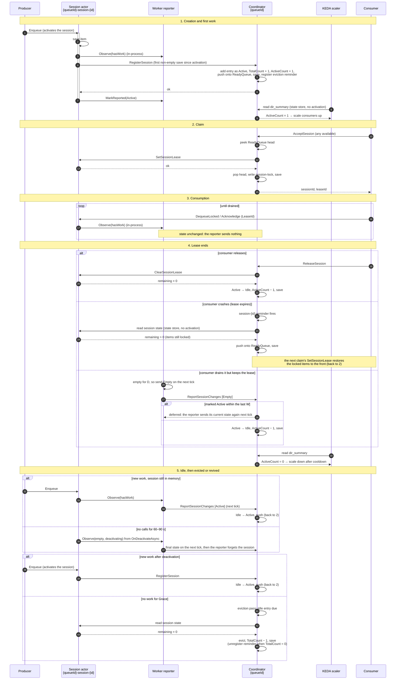

# Session directory: one structure for scaling, claiming and eviction

**Supersedes:** an earlier draft (active-session-count) that kept a separate
set of active sessions next to the session directory. This one puts the same idea into the
directory itself.

**Addresses:** directions 1 and 4 of
[keda-sessions-depth-read-is-unbounded.md](../docs/issues/keda-sessions-depth-read-is-unbounded.md).
It makes directions 2, 3 and 6 unnecessary, and defers direction 5 (see
[Why the directory isn't segmented](#why-the-directory-isnt-segmented)).

## Context

`SessionCoordinatorActor` keeps one directory per queue,
`SessionCoordinatorMetadata.SessionDirectory`. It is a `Dictionary<string, SweepCandidate>` stored
in a single `metadata` key. Three things read it, and each one works out the same fact, **which
sessions have work**, in its own way:

| Reader | What it needs | How it gets it today | Cost |
|---|---|---|---|
| KEDA scaler (`mode: sessions`) | how many sessions have work | walks the directory and reads every session's `metadata` | N + 1 reads, about once a second for each ScaledObject |
| Any-available `AcceptSession` | an unleased session to hand out | sorts every entry by `LastClaimedAt`, then checks leases in that order | O(N) per claim; **ignores whether the session has work** |
| Hourly directory sweep | sessions that are empty and can be evicted | checks up to 200 entries an hour, and needs two empty readings an hour apart | evicts at most about 100 sessions an hour |

Because the sweep evicts so slowly, the directory grows without limit whenever sessions are created
faster than about 100 an hour. That growth makes all three costs worse.

The claim path has a quality problem as well as a cost problem. On a queue with 10k drained sessions
and one session with work, a consumer will most likely be handed an empty session. It drains
nothing, releases the session and claims again, while the session with work waits behind the empty
ones.

## Proposal

Each directory entry records whether its session has work. The workers that host the sessions
detect changes and tell the coordinator about them, so the coordinator never has to read sessions
to find out:

- **On a session's first work after activation**, the session calls `RegisterSession` directly.
  It becomes claimable and counted as soon as the call returns.
- **On every call**, the session tells its worker's reporter, in-process, whether it has work. The
  reporter keeps the latest state of each session hosted on that worker. Every 10 s it sends the
  coordinator **only the changes**: a session that got work, or one that has been empty long enough
  to be sure.
- **The coordinator** applies those changes. It defers an "empty" report that arrives soon after
  the session was last marked Active, because that report may be older than the registration.

Everything else is derived from the directory:

- **Scaler:** reads `ActiveCount` from one small key.
- **Any-available claim:** takes the head of a FIFO of sessions that have work and no lease.
- **Eviction:** removes entries that have been idle for longer than a grace period, once a final
  read confirms they are still empty.

```
session actor ── first work after activation ── RegisterSession (direct) ────────────────────▶ coordinator
session actor ── every call ── Observe (in-process) ──▶ worker reporter ── changes, every 10 s ──▶ coordinator

scaler        ──▶ dir_summary.ActiveCount   (written by the coordinator)
AcceptSession ──▶ ReadyQueue (FIFO)         (filled by the coordinator)
eviction pass ──▶ final read of Idle entries, then evict
```

### Parameters

| Name | Value | Meaning | Constraint |
|---|---|---|---|
| Tick | 10 s | how often a reporter sends changes | |
| RegisterSessionTimeout | 2 s | timeout on the session's direct `RegisterSession` call | well above a normal coordinator turn; breaks the cross-chain deadlock (see the session actor section) |
| D (empty debounce) | 30 s | how long a session must stay empty before the reporter says so | absorbs flapping |
| W (deferral window) | 30 s | an Empty report this soon after the session was last marked Active is deferred | **W > the reporter's call timeout** |
| Grace | 10 min | how long an entry stays Idle before its final eviction read | Grace ≫ W |
| Backstop | 1 h, doubling to 24 h | how often an Active, unleased entry is read as a safety net | |

### Entry states

```
   RegisterSession / Active report             AcceptSession
(new) ─────────────────────────────▶ Active ─────────────────▶ Active + leased
                                     ▲  │ ▲                          │
     RegisterSession / Active report │  │ └─ lease ends, items remain ┘ (pushed back onto the ReadyQueue)
                                     │  ▼
                                     Idle ◀── Empty report (not deferred), lease ends with nothing left,
                                      │       or a backstop read finds it empty
                                      │
                                      └── idle past Grace, a final read confirms empty ──▶ evicted
```

- **Active:** the session is believed to hold items, either queued or locked. Set by
  `RegisterSession`, an Active report, or a read that finds items.
- **Idle:** an Empty report, the end of a lease or a read found the session empty. A session that
  has never held an item has no entry at all.
- **Leased:** recorded separately in `session-lock_{id}`, as today. An Active session can be leased
  or unleased.

**Invariant:** every Active, unleased session is in the ReadyQueue exactly once (its `Queued` flag
is set). Every transition below preserves this, and the backstop repairs it if anything slips.

### Session lifecycle



### State layout

The coordinator keeps one `metadata` blob, plus one small key for the scaler:

| Key | Contents | Read by |
|---|---|---|
| `metadata` | the directory and the ReadyQueue | coordinator, admin |
| `dir_summary` | the counts | scaler, admin |
| `session-lock_{id}` | unchanged | coordinator |

```csharp
public record SessionCoordinatorMetadata
{
    public Dictionary<string, SessionEntry> SessionDirectory { get; init; } = new();
    public List<string> ReadyQueue { get; init; } = new();   // FIFO of Active, unleased session ids
}

public record SessionEntry                                    // replaces SweepCandidate
{
    public bool Active { get; init; }
    public bool Queued { get; init; }                         // currently in the ReadyQueue
    public double? IdleSince { get; init; }                   // replaces FirstConfirmedEmptyAt
    public double NextCheckAt { get; init; }                  // Idle: eviction read; Active: backstop read
    public double BackoffSeconds { get; init; }
}

public record DirectorySummary
{
    public int TotalCount { get; init; }
    public int ActiveCount { get; init; }                     // the scaler's NonEmptySessions
}
```

- **`metadata` and `dir_summary` are always written in the same `SaveStateAsync`**, a single
  transaction, so they can't drift apart. Without `dir_summary`, every scaler read would have to
  fetch the whole directory.
- **Writes happen only on state changes and claims.** Reports arrive only when something changed,
  and an Active report for an Active entry writes nothing.
- **`LastClaimedAt` is removed.** FIFO order provides fairness instead: a session joins the tail
  when it gets work, or when its lease ends.

Nothing new is persisted on the session actor. [Example state](#example-state) shows every place
that holds state, with values.

All directory access inside the coordinator goes through a small set of private helpers:
`GetEntry`, `SetEntry`, `RemoveEntry`, `PushReady`, `PopReady` and `Summary`. That keeps the storage
layout replaceable (see [Why the directory isn't segmented](#why-the-directory-isnt-segmented)).

### Session actor: observe every call, register on first work

```csharp
// QueueActor.cs
private bool _registered; // memory only: reset on every activation

protected override async Task OnPostActorMethodAsync(ActorMethodContext context)
{
    if (!TryGetSessionIdentity(out var queueId, out var sessionId)) return; // not a session, or a session's DLQ

    bool hasWork = await HasWorkAsync();                  // from StateManager's cache, no I/O
    _activityReporter.Observe(queueId, sessionId, hasWork);

    if (!hasWork || _registered) return;
    _registered = true;
    try
    {
        await _sessionCoordinatorActorInvoker.InvokeMethodAsync<RegisterSessionRequest, RegisterSessionResponse>(
            new ActorId(queueId), ActorMethodNames.RegisterSession, new RegisterSessionRequest { SessionId = sessionId });
        _activityReporter.MarkReported(queueId, sessionId, hasWork: true); // the coordinator already knows
    }
    catch (Exception ex)
    {
        // Not retried directly: the reporter still has this session as unsent, and sends Active next tick
        Logger.LogWarning(ex, "RegisterSession failed for {SessionId}; the reporter will send it", sessionId);
    }
}

protected override async Task OnDeactivateAsync()
{
    if (TryGetSessionIdentity(out var queueId, out var sessionId))
        _activityReporter.Observe(queueId, sessionId, await HasWorkAsync(), deactivating: true);
}

// queues[*].count + lockCount > 0
private async Task<bool> HasWorkAsync()
{
    var metadata = await StateManager.TryGetStateAsync<ActorMetadata>("metadata");
    return metadata.HasValue && metadata.Value.Queues.Values.Sum(q => (long)q.Count) + metadata.Value.LockCount > 0;
}
```

- **`Observe` is an in-process method call**, so sending it on every call costs nothing. The
  reporter, not the session, decides what is worth sending.
- **Registration only happens once there's work.** `OnActivateAsync` runs before the method that
  triggered it, so the new item isn't saved yet at that point. And activation isn't always caused
  by an enqueue: a dequeue on an empty session or a targeted `AcceptSession` also activate it.
- **The number of direct calls doesn't change:** at most one per activation, as today. It moves
  from activation to the first non-empty save.
- **Locked items count as work.** A session abandoned mid-consumption keeps its items in locks until
  the next lease restores them, so it has to stay claimable. This is the same `IsEmpty` rule the
  sweep uses today ([SessionCoordinatorActor.cs:504-511](../server/src/DaprMQ/SessionCoordinatorActor.cs#L504-L511)).
- **No call back into the coordinator from its own calls.** The hook skips the direct
  `RegisterSession` after `SetSessionLease` and `ClearSessionLease`. Those come from the
  coordinator, which learns the session's state from them anyway, and calling back mid-turn would
  be an A → B → A chain. Today's registration on activation made exactly that call (the path
  `SessionReentrancyTests` covers); this removes it. Reports go through the worker reporter, so
  they add no reentrancy path either.
- **`RegisterSession` has a timeout (`RegisterSessionTimeout`, 2 s), which breaks a cross-chain
  deadlock.** The session makes the call inside its own turn, holding its own lock. Now suppose a
  coordinator turn that will call this session (`SetSessionLease` from a claim or renewal,
  `ClearSessionLease` from a release) overlaps that turn **at any point**: during activation, the
  enqueue, its save, or the call itself, and in either order. Each actor then waits for the
  other's lock. They're on separate call chains, so reentrancy doesn't let either call in. Without
  a timeout, the wait lasts until the actor client's HTTP timeout, which stalls every claim,
  release, renewal and report for the queue.
  - **One timeout is enough.** Every such cycle includes the session waiting on `RegisterSession`,
    because that is the only call a session makes into the coordinator.
  - **When it fires,** the error is swallowed and the session's turn ends. The coordinator's call
    then goes through, so the waiting claim succeeds about 2 s late rather than failing. Nothing
    was marked reported, so the reporter sends Active on its next tick.
  - **Today's registration on activation had the same cycle,** on every activation and with no
    timeout.
  - **The timeout has to stay well above a normal coordinator turn** (at most an eviction pass's
    250 ms plus a save, or one lease sync). Otherwise new sessions fall back to the reporter's
    tick.
- **`OnDeactivateAsync` isn't guaranteed to run** (a process crash skips it). It is an early
  signal, not something correctness depends on. See [Accuracy](#accuracy).
- **`TryGetSessionIdentity`** is the id parsing pulled out of `RegisterAsSessionActorIfNeededAsync`,
  which this replaces. It keeps the dead-letter exclusion.

### Worker: track state, send changes

Each worker runs one `SessionActivityReporter` (a singleton and a `BackgroundService`). It tracks
every session hosted on its worker, and remembers what it last told the coordinator about each one.

```csharp
private sealed class TrackedSession
{
    public bool HasWork;
    public DateTimeOffset ChangedAt;   // when HasWork last flipped
    public bool? LastSent;             // what the coordinator was last told; null = unknown, so send the current state
    public bool Deactivating;
}

private readonly object _gate = new();
private readonly Dictionary<(string QueueId, string SessionId), TrackedSession> _sessions = new();

public void Observe(string queueId, string sessionId, bool hasWork, bool deactivating = false)
{
    lock (_gate)
    {
        if (!_sessions.TryGetValue((queueId, sessionId), out var s))
            _sessions[(queueId, sessionId)] = s = new TrackedSession { HasWork = hasWork, ChangedAt = Now() };
        else if (s.HasWork != hasWork) { s.HasWork = hasWork; s.ChangedAt = Now(); }
        s.Deactivating = deactivating;
    }
}

// What to send for one session this tick, or null for nothing
private static bool? ToSend(TrackedSession s, DateTimeOffset now) =>
    s.HasWork                                              ? true    // Active goes on the next tick
    : s.Deactivating || now - s.ChangedAt >= EmptyDebounce ? false   // Empty once it has settled, or the actor is leaving
    : null;                                                          // still settling

protected override async Task ExecuteAsync(CancellationToken ct)
{
    using var timer = new PeriodicTimer(TimeSpan.FromSeconds(10));
    while (await timer.WaitForNextTickAsync(ct))
    {
        // per queue: sessions where ToSend(s, now) is not null and differs from s.LastSent
        var batches = TakeChanges();

        await Parallel.ForEachAsync(batches, ct, async (batch, token) =>
        {
            try
            {
                var response = await _invoker.InvokeMethodAsync<ReportSessionChangesRequest, ReportSessionChangesResponse>(
                    new ActorId(batch.QueueId), ActorMethodNames.ReportSessionChanges,
                    new ReportSessionChangesRequest { Changes = batch.Changes });
                MarkSent(batch, except: response.Deferred);   // a deferred session stays unsent: its current state goes next tick
            }
            catch (Exception ex)
            {
                // Nothing is marked sent, so the next tick sends each session's state as it is then
                _logger.LogDebug(ex, "Session report to {QueueId} failed; resending current state next tick", batch.QueueId);
            }
        });

        ForgetDeactivatedOnceSent();
    }
}
```

- **The coordinator gets only lasting changes.** A session that flips between empty and non-empty
  a hundred times inside the debounce window, and ends up non-empty, sends nothing, because it was
  already Active. A quiet system sends no calls at all.
- **Active goes out on the next tick; Empty waits for D.** That asymmetry is what makes the
  coordinator's view err high rather than low.
- **Retries never send stale state.** A failed or deferred batch isn't resent as it was. The next
  tick compares each session's *current* state with `LastSent`. So within one reporter, reports
  always arrive in order.
- **A session activated while empty** (for example by a dequeue) starts with `LastSent` null, so
  it sends Empty after D. That corrects a coordinator that still has it as Active from a lost
  report.
- **Memory is bounded by the sessions in memory on the worker.** An entry is forgotten once its
  deactivation has been sent.
- **A lease end updates the reporter's record too.** Release and expiry change what the
  coordinator believes without a report from this worker. If the reporter didn't follow, a session
  drained and released, then given new work before D, would look "already reported Active" and
  never be sent.
  - **On release,** the coordinator marks the session Idle exactly when `ClearSessionLease` finds
    nothing left. So the session's hook records that same state with `MarkReported`.
  - **On expiry,** the coordinator doesn't call the session, so the session can't know what it
    decided. The first call that sees the lapsed lease uses `ResetReported`, so the next tick sends
    the session's current state.

The load on the coordinator grows with the number of changes, batched per worker, not with the
number of sessions or calls.

### Coordinator: registrations and changes

`RegisterSession` is the single-session, direct form of an Active change.

```csharp
private readonly Dictionary<string, double> _lastActiveAt = new(); // memory only; entries older than W are pruned

public Task<RegisterSessionResponse> RegisterSession(RegisterSessionRequest request) =>
    ApplyChangesAsync([new SessionChange(request.SessionId, HasWork: true)]);

public async Task<ReportSessionChangesResponse> ReportSessionChanges(ReportSessionChangesRequest request)
{
    double now = Now();
    var metadata = await GetMetadataAsync();
    var summary = await GetSummaryAsync();
    var deferred = new List<string>();
    bool changed = false;

    foreach (var change in request.Changes)
    {
        metadata.SessionDirectory.TryGetValue(change.SessionId, out var entry);

        if (change.HasWork)
        {
            _lastActiveAt[change.SessionId] = now;
            if (entry is { Active: true }) continue;               // already Active: no write

            // Unknown → added. This also closes today's race between an eviction and an enqueue
            // into a session actor that is still in memory.
            if (entry == null) summary = summary with { TotalCount = summary.TotalCount + 1 };
            entry = (entry ?? new SessionEntry()) with
            {
                Active = true, IdleSince = null, BackoffSeconds = 0, NextCheckAt = now + BackstopSeconds
            };
            summary = summary with { ActiveCount = summary.ActiveCount + 1 };
            if (!entry.Queued && !await IsLeasedAsync(change.SessionId, now))
            {
                metadata.ReadyQueue.Add(change.SessionId);
                entry = entry with { Queued = true };
            }
        }
        else
        {
            if (entry is not { Active: true }) continue;           // unknown or already Idle: nothing to do

            // This Empty may have been sent before a registration or Active report that arrived
            // first. Ask for it again once W has passed.
            if (_lastActiveAt.TryGetValue(change.SessionId, out var at) && now - at < DeferralWindowSeconds)
            {
                deferred.Add(change.SessionId);
                continue;
            }

            entry = entry with { Active = false, IdleSince = now, NextCheckAt = now + GraceSeconds };
            summary = summary with { ActiveCount = summary.ActiveCount - 1 };
            // if Queued, the id stays in the ReadyQueue and is dropped when a claim reaches it
        }

        metadata.SessionDirectory[change.SessionId] = entry;
        changed = true;
    }

    if (changed)
    {
        await SetMetadataAndSummaryAsync(metadata, summary);
        await StateManager.SaveStateAsync();
        await EnsureEvictionReminderAsync();
    }
    return new ReportSessionChangesResponse { Success = true, Deferred = deferred };
}
```

(The real implementation copies the dictionary before changing it, as the existing methods do. The
code above changes it in place to keep the sketch short.)

**Why deferring only Empty reports is enough.** The two possible mistakes aren't equally bad:

| Wrong state at the coordinator | Effect | Heals? |
|---|---|---|
| Says Active, session is empty | counted too high; at worst one claim gets an empty session | **Yes, on its own.** A leased session is corrected when its lease ends, which checks `remaining`. An unleased one is in the ReadyQueue, so the next claim hands it out and that lease's end corrects it. Failing both, the backstop read finds it. |
| Says Idle, session has work | work nobody can claim; consumers may be scaled away | Only at the eviction read, up to `Grace` later |

Dequeues aren't lease-gated while a session holds no lease, so an unleased session can be drained
too. That doesn't change the healing: it is still in the ReadyQueue. So Active is always applied,
and only Empty is guarded. A stale Empty can only come from a
different path than the Active it races:
- the direct `RegisterSession`, racing a reporter tick already in flight;
- a different worker's reporter, after a deactivation and reactivation elsewhere.

Within one reporter, ordering is guaranteed (see above). So an Empty that arrives within W of the
last Active can be held back. W only has to be longer than a reporter call can take in flight,
because retries carry current state rather than resending old batches.

If the coordinator reactivates, `_lastActiveAt` is lost. It then treats every Active entry as
marked Active at its activation time, which only means it defers Empty reports for the first W.

### Coordinator: any-available claim

```csharp
// Any-available AcceptSession
int attempts = 0;
while (attempts++ < MaxClaimAttempts && metadata.ReadyQueue.Count > 0)
{
    string sessionId = metadata.ReadyQueue[0];
    metadata.SessionDirectory.TryGetValue(sessionId, out var entry);
    if (entry is not { Active: true } || await IsLeasedAsync(sessionId, now))
    {
        PopReady(metadata, sessionId);                          // stale: remove it from the queue and clear Queued
        continue;
    }

    if (!await TrySyncSessionLeaseAsync(sessionId, leaseId, expiresAt))
    {
        RotateReadyToTail(metadata, sessionId);                // a broken session actor mustn't block the head
        continue;
    }

    PopReady(metadata, sessionId);
    // write session-lock_{sessionId}, metadata and dir_summary in one save, then register the expiry reminder, as today
    return Claimed(sessionId, leaseId, expiresAt);
}
// save any stale pops
return NoSessionsAvailable();
```

- **Each stale id is removed exactly once.** `MaxClaimAttempts` (for example 16) caps the work in a
  single call, so a burst of stale ids is spread over several calls.
- **The lease sync is a cross-actor await.** After it, re-read `metadata`, as `AcceptSession`
  already does today, so that a change arriving during the sync isn't overwritten.
- **The ReadyQueue is filled in three places:**
  - an Active change for an unleased session (above);
  - the end of a lease, if the session still holds items (below);
  - the backstop, which repairs the invariant.
- **Targeted `AcceptSession`** still works on Idle and empty sessions, and still returns
  `SESSION_NOT_FOUND` for unknown ones. One case changes: a session that has never held an item is
  now unknown, because it registers only on its first work. If the session is `Queued`, it stays
  in the queue and is skipped when it reaches the head.

### Coordinator: lease end

When a lease ends, the session may have just been drained, and the reporter's Empty may not have
arrived yet. So the end of a lease checks for remaining items before pushing the session back
onto the ReadyQueue:

- **`ReleaseSession`** already calls `ClearSessionLease` on the session actor.
  `ClearSessionLeaseResponse` gains `Remaining` (`ItemCount + LockCount`). The coordinator uses it
  in the same turn:
  - 0 makes the entry Idle and decrements `ActiveCount`;
  - more than 0 pushes the session.
- **The lease-expiry reminder** (`session-{id}`) reads the session's state through
  `IQueueActorStateReader`, as the sweep does today, without activating the session, and applies
  the same rule.
- **If the call or the read fails**, the coordinator treats the session as still holding items and
  pushes it. That errs toward availability: at worst, one claim gets an empty session.

A consumer that releases a drained session therefore lowers `ActiveCount` straight away.

### Coordinator: the eviction pass

A new `directory-evict` reminder replaces the hourly `directory-sweep` reminder:
- it runs every 30 s while `TotalCount > 0`, and unregisters itself when the directory is empty;
- each tick scans the directory in memory, makes at most `MaxReadsPerPass` (64) session state reads
  (described below) within `MaxPassDuration` (250 ms), and saves once. See
  [Bounding the eviction pass](#bounding-the-eviction-pass).

Active entries are normally never read: the reporters say when they drain. The pass reads them only
as a slow backstop.

#### What a session state read is

It's the same read today's sweep and the lease-expiry path use:
`IQueueActorStateReader.ReadSessionStateAsync` ([QueueActorStateReader.cs:88](../server/src/DaprMQ/QueueActorStateReader.cs#L88)).

1. **The coordinator calls its own worker's Dapr sidecar:**
   `GET /v1.0/actors/{QueueActorType}/{queueId}-session-{sessionId}/state/metadata`.
2. **The sidecar does one primary-key lookup in the state store** (Postgres) for the session
   actor's `metadata` key.
3. **It returns the session's `ActorMetadata` JSON**, and the reader reduces it to
   `SessionActorState(ItemCount, LockCount, LeaseExpiresAt)`:
   - `ItemCount` is the sum of `queues[*].count`;
   - `LockCount` is `lockCount`;
   - the session is empty when both are 0.

What it doesn't do:
- **It doesn't activate the session actor or wait for its turn.** It reads storage directly,
  bypassing placement, so a check never wakes a cold session or queues behind a busy one. The
  catch is that it sees the last **saved** state. That's fine here, because a session only changes
  emptiness through a method that saves before it returns.
- **It doesn't read items.** Segments (`queue_{priority}_seg_{n}`), lock records (`{lockId}-lock`)
  and the lock index aren't touched, so it costs one small read, however many items the session
  holds.

If the read fails, or `metadata` is missing, the result is inconclusive. The pass leaves the entry
unchanged and tries again next tick (it fails closed, as the sweep does today).

| Entry | Due when | Read result | Action |
|---|---|---|---|
| Idle, unleased | `NextCheckAt` (idle + `Grace`) has passed | empty | **evict**: remove the entry, `TotalCount--` |
| Idle, unleased | same | has items | → Active, `ActiveCount++`, push (repairs a lost Active report) |
| Idle, leased | `NextCheckAt` has passed | (no read) | `NextCheckAt = now + Grace` |
| Active, unleased | `NextCheckAt` (backstop) has passed | empty | → Idle, `ActiveCount--` (repairs a lost Empty report) |
| Active, unleased | same | has items | back off: 1 h doubling to 24 h; push if not `Queued` |
| Active, leased | `NextCheckAt` has passed | (no read) | `NextCheckAt = now + Backstop`; the lease end will decide |
| any | read fails | n/a | leave the entry unchanged and retry next tick (fails closed, as today) |
| Active, not queued, lease lapsed | every pass (expiry reminder never fired) | (no read) | push onto the ReadyQueue; a wrong push heals at that claim's lease end |

`Grace` is 10 minutes. An eviction still takes two empty readings at least `Grace` apart: the one
that made the entry Idle (an Empty report, a lease end, or a backstop read) and the final read.
That is today's `FirstConfirmedEmptyAt` safety rule, with a 10-minute gap instead of an hour.

**Evicting can't lose a later enqueue.** If new work arrives after the final read, the session
either reports Active (if it's still in memory) or registers (if it reactivates). Both create the
entry again if it has gone.

#### Bounding the eviction pass

The pass runs inside the coordinator's turn, and the coordinator handles one call at a time. While
the pass runs, `AcceptSession`, `RegisterSession`, `ReleaseSession` and report batches for the queue
all wait. So the pass is bounded in **time**, and separately in **reads**:

| Bound | Default | Protects |
|---|---|---|
| `MaxPassDuration` | 250 ms | callers waiting on the coordinator: a hard cap on how long one pass holds the turn |
| `MaxReadsPerPass` | 64 | Postgres: a backlog becomes a steady trickle, not a burst on the sidecar connections every actor's `SaveStateAsync` shares (the kind of burst Problem 2 of the issue describes) |
| Read parallelism | 16 | pass duration: 64 reads take about as long as 4 sequential ones, as in `QueueDepthService` |
| `CatchUpDelay` | 2 s | the gap between passes while a backlog drains, so other calls get the coordinator in between |

```csharp
private static readonly TimeSpan MaxPassDuration = TimeSpan.FromMilliseconds(250);

private async Task EvictionPassAsync()
{
    double now = Now();
    var due = DueEntries(now).Take(MaxReadsPerPass).ToList();   // in-memory scan, no I/O
    var results = new ConcurrentDictionary<string, SessionActorState>();

    using var deadline = new CancellationTokenSource(MaxPassDuration);
    try
    {
        await Parallel.ForEachAsync(due,
            new ParallelOptions { MaxDegreeOfParallelism = 16, CancellationToken = deadline.Token },
            async (sessionId, ct) =>
            {
                try { results[sessionId] = await _queueActorStateReader.ReadSessionStateAsync(SessionActorId(sessionId), ct); }
                catch (Exception) when (!ct.IsCancellationRequested) { /* inconclusive: no result */ }
            });
    }
    catch (OperationCanceledException) { /* deadline hit: in-flight reads are aborted, finished ones are kept */ }

    bool changed = Apply(results, now);   // entries without a result are left exactly as they were
    if (changed) await StateManager.SaveStateAsync();

    if (deadline.IsCancellationRequested || DueEntries(Now()).Any())
        await ScheduleCatchUpAsync(CatchUpDelay);                 // one-shot reminder; the turn is released in between
}
```

- **The cap is hard for the reads.** The deadline's token is passed down to the sidecar HTTP call,
  so when it fires every in-flight read is aborted rather than awaited. A slow or hung read can't
  stretch the pass.
- **Cutting a pass short is always safe.** The reads have no side effects. An entry whose read
  didn't finish has no result, so it's treated like a failed read: left unchanged and tried again
  on the next pass. Nothing is evicted or changed on partial information.
- **The save isn't covered by the cap.** Cancelling a save half-way would leave the turn's changes
  uncommitted, so the pass always finishes its one save. The worst-case hold is therefore
  `MaxPassDuration` plus one `SaveStateAsync`, the same cost every claim already pays.
- **Catch-up passes yield.** A pass that hits either bound with entries still due doesn't loop. It
  schedules a one-shot reminder `CatchUpDelay` later and returns, so claims and reports queued behind
  it run first. While a backlog drains, the coordinator spends at most
  250 ms / (250 ms + 2 s), about 11% of its time, on eviction.

The same rule covers the other reads and calls the coordinator makes inside a turn: the lease-expiry
read and `ClearSessionLease` on release. Each gets a per-call timeout (for example 2 s). A timeout
is treated as "still has items" and the session is pushed, the same fail-safe direction as any
other failure.

**Capacity.** Each evicted session costs one read (the final one).

| Cadence | Reads | Evictions per hour per queue |
|---|---|---|
| normal (every 30 s) | 64 per 30 s | ~7,700 |
| catching up (every ~2.25 s) | 64 per pass | ~100,000 |
| today | 200 per hour, two each | ~100 |

**Going over capacity is safe.** If sessions are created faster than the passes can evict them, due
Idle entries wait for a later pass. A waiting entry is correct, just not yet removed: it is already
Idle, so it isn't counted, isn't claimable, and costs only its ~100 bytes in the `metadata` blob.

**If a workload outgrows that,** the reads can move out of the coordinator's turn. A worker-side
service reads the due entries and sends the coordinator only the results. The turn then only
applies results, so capacity is bounded by Postgres, not by how long claims can wait. It adds a
moving part, so it's only worth building if the numbers above prove too low.

### Scaler and admin reads

```csharp
// QueueDepthService.cs
private async Task<QueueDepthResult> GetSessionsDepthAsync(string queueId, CancellationToken ct)
{
    var summary = await _reader.ReadStateAsync<DirectorySummary>(_sessionCoordinatorActorType, queueId, "dir_summary", ct);
    return new QueueDepthResult { QueueId = queueId, NonEmptySessions = summary?.ActiveCount ?? 0 }; // no summary = no sessions yet
}
```

- **Sessions mode no longer fills in `Ready` and `Locked`.** Only the scaler calls
  `/internal/queue-depth`, and in sessions mode it reads only `NonEmptySessions`.
- **The admin console** keeps reading the session ids from `metadata` through
  `ReadSessionDirectoryAsync`, which only needs its record type updated. The console could also
  show each session's `Active` flag.

## Example state

This section shows one snapshot of queue `orders` with eight sessions, as each place that holds
state would see it. Timestamps are Unix seconds: `now` = `1791972000` (2026-10-14 10:00:00 UTC).
JSON is camelCase, as Dapr's actor state serializer writes it.

| Session | Coordinator says | Leased | In the ReadyQueue | What's actually happening |
|---|---|---|---|---|
| `order-1001` | Active | yes | no | A consumer is working through it |
| `order-1002` | Active | no | yes | Registered 5 s ago on its first enqueue |
| `order-1003` | Active | no | yes | Registered 3 s ago |
| `order-1004` | Active | yes | no | Drained 38 s ago, but the consumer still holds the lease. The reporter sends Empty on the next tick. |
| `order-0990` | Active | no | yes | Has items, but no consumer has claimed it. A backstop read an hour ago found items. |
| `order-0995` | Idle | no | yes (stale) | A targeted claim took it while it was queued; it was released empty |
| `order-0997` | Idle | no | no | Released empty 500 s ago; its final eviction read is due in 100 s |
| `order-0998` | Idle | no | no | Released empty 50 s ago, still in memory, and got a new enqueue 4 s ago. The reporter sends Active on the next tick. |

### Coordinator actor `orders`: persisted

**`metadata`**: the directory and the ReadyQueue.

```json
{
  "sessionDirectory": {
    "order-1001": { "active": true,  "queued": false, "idleSince": null,       "nextCheckAt": 1791975569, "backoffSeconds": 0 },
    "order-1002": { "active": true,  "queued": true,  "idleSince": null,       "nextCheckAt": 1791975595, "backoffSeconds": 0 },
    "order-1003": { "active": true,  "queued": true,  "idleSince": null,       "nextCheckAt": 1791975597, "backoffSeconds": 0 },
    "order-1004": { "active": true,  "queued": false, "idleSince": null,       "nextCheckAt": 1791975400, "backoffSeconds": 0 },
    "order-0990": { "active": true,  "queued": true,  "idleSince": null,       "nextCheckAt": 1791975600, "backoffSeconds": 7200 },
    "order-0995": { "active": false, "queued": true,  "idleSince": 1791971880, "nextCheckAt": 1791972480, "backoffSeconds": 0 },
    "order-0997": { "active": false, "queued": false, "idleSince": 1791971500, "nextCheckAt": 1791972100, "backoffSeconds": 0 },
    "order-0998": { "active": false, "queued": false, "idleSince": 1791971950, "nextCheckAt": 1791972550, "backoffSeconds": 0 }
  },
  "readyQueue": ["order-0990", "order-0995", "order-1002", "order-1003"]
}
```

- **`readyQueue` is ordered by how long each session has waited.** `order-0990` has waited longest,
  so the next any-available claim gets it.
- **`order-0995` is a stale id.** The next claim to reach it sees `active: false`, removes it from
  the queue and clears `queued`, then moves on.
- **Active entries' `nextCheckAt`** is the backstop: one hour after they became Active. For
  `order-0990`, the first backstop read found items, so the backoff doubled to 2 h.
- **Idle entries' `nextCheckAt`** is `idleSince` + `Grace`: the final eviction read.

**`dir_summary`**: the only key the scaler reads. It is written in the same save as `metadata`.

```json
{ "totalCount": 8, "activeCount": 5 }
```

**`session-lock_order-1001`**: unchanged from today (`order-1004` has one like it).

```json
{ "sessionId": "order-1001", "leaseId": "aB3dE5fG7hJ", "createdAt": 1791971980, "expiresAt": 1791972040 }
```

**Reminders**, held by the Dapr scheduler:

| Name | Due | Period | Purpose |
|---|---|---|---|
| `directory-evict` | every 30 s | 30 s | the eviction pass; unregistered when `totalCount` reaches 0 |
| `session-order-1001` | `1791972040` | once | lease expiry (unchanged from today) |
| `session-order-1004` | its lease expiry | once | lease expiry |

### Coordinator actor `orders`: in memory only

```csharp
// when each session was last marked Active (registration or Active report); entries older than W are pruned
Dictionary<string, double> _lastActiveAt = new()
{
    ["order-1002"] = 1791971995,   // RegisterSession 5 s ago: an Empty for it now would be deferred
    ["order-1003"] = 1791971997,   // RegisterSession 3 s ago
};
```

`order-1004` was last marked Active 200 s ago, so the Empty about to arrive for it is applied
straight away.

### Session actor `orders-session-order-1001`: persisted (unchanged)

**`metadata`** (`ActorMetadata`). The proposal doesn't change it. The coordinator only reads it,
through `IQueueActorStateReader`, at the end of a lease and in the eviction pass.

```json
{
  "config": { "segmentSize": 100, "bufferSegments": 1, "dedupEnabled": true },
  "queues": { "1": { "headSegment": 0, "tailSegment": 0, "count": 3, "headOffloadedSegment": null, "tailOffloadedSegment": null } },
  "errorMessage": null,
  "lockCount": 1,
  "activeSessionLeaseId": "aB3dE5fG7hJ",
  "activeSessionLeaseExpiresAt": 1791972040,
  "lockExpiryBuckets": [],
  "nextSequence": 4
}
```

`queues[*].count + lockCount` = 4, so the session has work. The coordinator gets the same number
from `ClearSessionLeaseResponse.remaining` on release. The items themselves stay in
`queue_1_seg_0`, the lock in `{lockId}-lock`, and the lock index in `locks_session`, all as today.

### Session actor: in memory only

```csharp
bool _registered = true;   // RegisterSession sent on this activation's first non-empty save
```

It resets when the actor deactivates, so the next activation registers again on its first
non-empty save. That's all the session itself holds. Its reported state lives in the reporter.

### Worker reporter: in memory only

One `SessionActivityReporter` per worker process. Here is worker A's view; it hosts `order-1001`,
`order-1004` and `order-0998`:

```csharp
Dictionary<(string QueueId, string SessionId), TrackedSession> _sessions = new()
{
    // registered directly, unchanged since: nothing to send
    [("orders", "order-1001")] = new() { HasWork = true,  ChangedAt = 1791971969, LastSent = true,  Deactivating = false },
    // empty for 38 s (≥ D) after being reported Active: Empty goes on the next tick
    [("orders", "order-1004")] = new() { HasWork = false, ChangedAt = 1791971962, LastSent = true,  Deactivating = false },
    // revived 4 s ago after being reported Empty: Active goes on the next tick
    [("orders", "order-0998")] = new() { HasWork = true,  ChangedAt = 1791971996, LastSent = false, Deactivating = false },
};
```

On the next tick that becomes one call to the `orders` coordinator:

```json
{ "changes": [ { "sessionId": "order-1004", "hasWork": false }, { "sessionId": "order-0998", "hasWork": true } ] }
```

The response is `{ "success": true, "deferred": [] }`: `order-1004` goes Idle, and `order-0998`
goes Active and joins the tail of the ReadyQueue. `activeCount` stays 5.

### Messages

| Call | From → to | Example |
|---|---|---|
| `RegisterSession` | session actor → coordinator, direct | `{ "sessionId": "order-1003" }` → `{ "success": true }` |
| `ReportSessionChanges` | worker reporter → coordinator, every 10 s, only if there are changes | `{ "changes": [{ "sessionId": "order-1003", "hasWork": false }] }` → `{ "success": true, "deferred": ["order-1003"] }` (an Empty 3 s after its registration) |
| `ClearSessionLease` | coordinator → session actor, on release | (no body) → `{ "success": true, "remaining": 0 }` |
| `/internal/queue-depth` | operator → worker | `{ "queueId": "orders", "ready": 0, "locked": 0, "nonEmptySessions": 5 }` |

`ready` and `locked` are 0 because sessions mode no longer fills them in. `nonEmptySessions` is
`dir_summary.activeCount`.

### Catalog (unchanged)

The coordinator registers the queue, not its sessions, in catalog shard
`catalog-{ShardFor("orders")}`, which is `catalog-44`. The entry is stored under `entries`:

```json
{
  "orders": { "id": "orders", "kind": "Queue", "parentId": null, "registeredAt": "2026-10-14T09:12:31+00:00" }
}
```

Session actors are never catalogued (`CatalogEntry.ForQueueActorId` returns null for them), so the
catalog doesn't grow with sessions. The admin console lists sessions from the coordinator's
`metadata`.

### For comparison: the same directory today

```json
{
  "sessionDirectory": {
    "order-1001": { "firstConfirmedEmptyAt": null,       "nextCheckAt": 0,          "lastClaimedAt": 1791971980.4, "backoffSeconds": 0 },
    "order-1002": { "firstConfirmedEmptyAt": null,       "nextCheckAt": 0,          "lastClaimedAt": 0,            "backoffSeconds": 0 },
    "order-0997": { "firstConfirmedEmptyAt": 1791970100, "nextCheckAt": 1791970400, "lastClaimedAt": 1791971400.9, "backoffSeconds": 0 }
  }
}
```

This shape has no record of which sessions have work, and no ReadyQueue or summary. Every reader
has to read every session to answer its question.

## Behaviour changes

1. **An any-available claim never returns an empty session.** When no session has work, the claim
   returns `NO_SESSIONS_AVAILABLE`. All five SDKs already handle that code. Consumers also stop
   cycling through empty sessions, which reduces load.
2. **How soon a session becomes claimable after getting work depends on whether it is in memory.**
   - A brand-new session, or one coming back after deactivation, registers directly. It is
     claimable once its first enqueue returns.
   - A drained session that is still in memory and **unleased** (its lease was released or
     expired) waits for the reporter's next tick, up to 10 s, before it can be claimed again. A
     session stays in memory until about 60–90 s after its last call: the
     `ACTOR_IDLE_TIMEOUT_SECONDS` of 60 s, plus up to Dapr's 30 s scan interval.
   - A drained session whose consumer **still holds the lease** isn't delayed at all. The lease
     holder dequeues the new work directly, and no claim is involved. Only `ActiveCount` can lag,
     and only if the reporter had already sent Empty (see [Accuracy](#accuracy)).

   Today any session can be claimed straight away, but only if it happens to sort first.
3. **A targeted claim of a session that has never held an item returns `SESSION_NOT_FOUND`.** Today
   any activation registers the session.
4. **Claim order becomes first in, first out**: a session joins the queue when it gets work or when
   its lease ends. Today's order is least-recently-claimed. The two are equally fair, and the new
   order also favours the sessions that have waited longest for a consumer.
5. **Eviction keeps up with session creation.** A drained session is evicted about 10 minutes
   later, where today it can take up to a day.

## Accuracy

- **`ActiveCount` errs high, briefly.**
  - A session released after draining stops counting straight away.
  - A session drained while its consumer keeps the lease stops counting after D plus a tick (up
    to 40 s), or W after it was last marked Active if that is later.
- **It is low only briefly, or after a crash.**
  - **Briefly:** a session revived while still in memory is uncounted until the next tick, up to
    10 s. That applies whether or not it is leased, but only if the reporter had already sent Empty
    for it. If the new work arrived within D of the drain, the reporter never sent Empty, and the
    count never dropped.
  - **After a crash:** a worker crash loses the reporter's unsent changes, and `OnDeactivateAsync`
    doesn't run.

| Lost | Effect | How it heals |
|---|---|---|
| An Empty | stays Active: counted too high, still in the ReadyQueue | The next claim hands it out, and the release finds `remaining = 0`. If no consumer ever claims it, the backstop read finds it empty within an hour. |
| An Active (a revival in memory) | Idle: counted too low, not claimable | The eviction read finds it has work and promotes it, within `Grace`. |
| An Active for a session with no entry (its `RegisterSession` failed too) | not in the directory at all | Its next activation registers it. Today a failed registration has the same gap. |

  A lost Active affects claiming as well as scaling, which is why the eviction pass promotes an Idle
  entry it finds with work instead of just skipping it.
- **The ReadyQueue can hold stale ids** (evicted, Idle or leased), which claims drop lazily.

## Alternatives considered

- **The coordinator calls on every empty ↔ non-empty change, straight from the session.** A
  flapping session would send a call on every flip, all into the single coordinator for the queue.
  Sending the changes through the reporter keeps the per-flip cost in-process.
- **The coordinator detects drained sessions itself.** Sessions send throttled "still non-empty"
  refreshes, and the coordinator reads any session it hasn't heard from in 2T. This was an earlier
  version of this proposal. It needs continuous refresh traffic and reads every quiet session, and
  it takes up to about 90 s to notice a drain. The reporter already knows the session drained.
- **Versioned reports**, either a `StateVersion` bumped on every `metadata` write or a persisted
  generation plus an in-memory sequence. Both order reports correctly, but they need extra
  persisted state on the session and a version check on every change. Deferring Empty for W gets
  the same safety from the asymmetry between the two mistakes, with no persisted state.
- **Re-reading a fixed number of sessions per second, in rotation.** Its load is fixed, but the
  time to notice a revived session grows with N.
- **Segmented storage:** see the next section.

## Why the directory isn't segmented

Direction 5 of the issue proposes splitting the directory into 100-entry segments. This proposal
doesn't, for three reasons:

- **The directory no longer grows without limit.** With eviction keeping up, it holds roughly the
  sessions that have work now plus those created in the last `Grace`. At 500 new sessions an hour,
  that's about 100 entries.
- **Reads are cheap.** The actor's `StateManager` caches state, so the coordinator reads the blob
  from Postgres once per activation. The scaler reads `dir_summary`, not the blob.
- **Writes are limited to state changes and claims.**

What stays from Problem 4: every claim, release and state change rewrites the whole blob. That
costs about 100 bytes × entries × (claims + state changes) per second:

| Entries | Blob | At 50 claims/s |
|---|---|---|
| 500 | ~50 KB | ~2.5 MB/s |
| 10,000 | ~1 MB | ~50 MB/s |

So the unsegmented design stops working for **thousands of sessions holding work at the same
time** combined with a high claim rate. Session churn alone no longer causes it. If such a workload
appears, segmenting becomes a storage change behind the directory helpers (hash buckets plus a
segmented ReadyQueue), with no change in behaviour.

## Limits and costs

| | Today | Proposed |
|---|---|---|
| Scaler read, per ScaledObject per second | directory blob + N session reads | 1 small key |
| Any-available claim | sort N entries + lease reads; rewrite the directory | pop the queue head; rewrite the directory |
| Session actor hot path | 1 `RegisterSession` call per activation | 1 in-process `Observe` per call; 1 `RegisterSession` on the first non-empty save per activation |
| Calls into the coordinator | 1 per session activation | the same, plus ≤ 1 batch per worker per 10 s, **only when something changed** |
| Coordinator writes | every registration, claim and sweep | state changes and claims only |
| Background reads | ≤ 200 per hour | 1 final read per evicted session; backstop reads at most hourly per long-Active unleased session |
| Eviction capacity | ~100 sessions/hour | ~7,700 sessions/hour per queue at the default budget; ~100,000 while catching up (see [Bounding the eviction pass](#bounding-the-eviction-pass)) |
| Directory size | grows without limit under churn | ≈ sessions with work + sessions created in the last `Grace` |
| Idle queue (empty directory) | hourly reminder forever | no reminder, no reports |
| Worker memory | none | one small entry per session in memory on the worker |

## No migration

Existing coordinator state is not carried over. The new records replace `SweepCandidate` and the
old directory shape outright, with no versioning, conversion or scaler fallback.

## Tests (TDD order, per CLAUDE.md)

1. **Integration:**
   - **`OperatorScalerTests`:**
     - put work into 3 sessions and expect `NonEmptySessions == 3` as soon as the enqueues return;
     - drain one and release it, and expect 2 at once;
     - drain another without releasing it, and expect 1 within D plus a tick (parameters made
       short through configuration).
   - **Session claim tests:**
     - with 50 empty sessions and 1 with work, an any-available claim returns the one with work;
     - with all of them empty, it returns `NO_SESSIONS_AVAILABLE`;
     - a session revived while still in memory becomes claimable within a tick;
     - a targeted claim of a session that has never held an item returns `SESSION_NOT_FOUND`.
2. **`QueueDepthServiceTests`:** sessions mode reads only `dir_summary`, and a missing summary
   reports 0.
3. **`SessionActivityReporterTests`** (fake `TimeProvider`, mocked invoker):
   - Active is sent on the next tick; Empty only after D, or straight away when deactivating;
   - flapping within D that ends non-empty sends nothing if `LastSent` was Active;
   - a quiet tick sends no calls;
   - a session first observed empty sends Empty after D (`LastSent` null);
   - after a failed call, the next tick sends current state, not the failed batch;
   - a deferred session is sent again next tick with its current state;
   - `MarkReported` suppresses a duplicate Active;
   - a deactivated session is forgotten once its final state has been accepted.
4. **`QueueActorTests`** (session actor, mocked reporter and invoker):
   - every successful method calls `Observe` with the right `hasWork`, including locked-only
     sessions;
   - the first non-empty save after activation calls `RegisterSession` directly and then
     `MarkReported`;
   - activation alone, and empty saves, don't call `RegisterSession`;
   - a failed `RegisterSession` isn't retried directly, and doesn't call `MarkReported`;
   - `OnDeactivateAsync` calls `Observe` with `deactivating: true`;
   - a failed method, a non-session actor and a session DLQ actor never observe or register;
   - `ClearSessionLease` returns `Remaining`;
   - `SessionReentrancyTests` still pass with registration in the post-method hook.
5. **`SessionCoordinatorActorTests`** (mocked state and state reader):
   - **Changes:**
     - Active for an unknown session adds it as Active and Queued;
     - Idle → Active increments the count and queues the session;
     - Active for an Active entry writes nothing;
     - a leased session is not queued;
     - Empty for an Active entry makes it Idle, unless it was marked Active within W, in which
       case it is returned in `deferred` and nothing is written;
     - Empty for an unknown or Idle entry does nothing;
     - after the coordinator reactivates, Empty is deferred for W.
   - **Claims:**
     - claims come out in FIFO order;
     - stale ids (evicted, Idle, leased) are dropped;
     - a failed lease sync moves the session to the tail;
     - `MaxClaimAttempts` is respected;
     - targeted claims are unchanged.
   - **Lease end:**
     - release or expiry of a session with items queues it once;
     - release or expiry of an empty session makes it Idle and decrements `ActiveCount`;
     - a failed `ClearSessionLease` or state read queues it.
   - **Eviction pass:**
     - each row of the eviction table;
     - the per-tick read budget;
     - a pass whose reads hang returns within `MaxPassDuration` (plus its save), applies only the
       reads that finished, and leaves the rest unchanged;
     - a pass that hits a bound with entries still due schedules one catch-up pass, rather than
       looping inside the turn;
     - a lease-expiry read or `ClearSessionLease` that times out queues the session;
     - the reminder is registered and unregistered with `TotalCount`.
   - **Consistency:** every save writes `metadata` and `dir_summary` together, and the counts match
     the directory.
   - **Existing tests:** remove or rewrite the ones that expect an any-available claim to return
     an empty session, or that rely on `LastClaimedAt` ordering or the hourly sweep.

## Phases

Each phase can ship on its own.

1. **Reporting and the active count:**
   - the session hook (`Observe` on every call, `RegisterSession` moved to the first non-empty
     save, `OnDeactivateAsync`), the reporter, and `ReportSessionChanges` with deferral;
   - the Active and Idle states, `Remaining` at the end of a lease, and `dir_summary`;
   - switching the scaler to `ActiveCount`.

   Claims keep today's `LastClaimedAt` behaviour, and the hourly sweep keeps evicting. Until
   phases 2 and 3 remove them, `SessionEntry` carries `LastClaimedAt` and `FirstConfirmedEmptyAt`
   alongside the new fields.
2. **ReadyQueue:** switch any-available claims to the FIFO, and remove `LastClaimedAt`.
3. **Eviction pass:** the eviction and backstop rows. Retire `directory-sweep` and `SweepCandidate`.

## Open questions

1. **Parameters:** fixed, or configurable? Configurable is useful at least for tests. Whatever is
   chosen has to keep W > the reporter's call timeout, and Grace ≫ W. The eviction bounds
   (`MaxPassDuration`, `MaxReadsPerPass`, `CatchUpDelay`) are the ones operators would most likely
   want to tune.
2. **Segmenting:** at what number of sessions holding work at once should the directory be
   segmented? A load test with many concurrently active sessions and a high claim rate would set
   the threshold. (See [Why the directory isn't segmented](#why-the-directory-isnt-segmented).)
3. **Revival latency:** if the up-to-10 s delay matters for unleased sessions revived while
   still in memory, the reporter could flush Active changes for sessions it last reported Empty
   straight away, instead of waiting for the tick.
