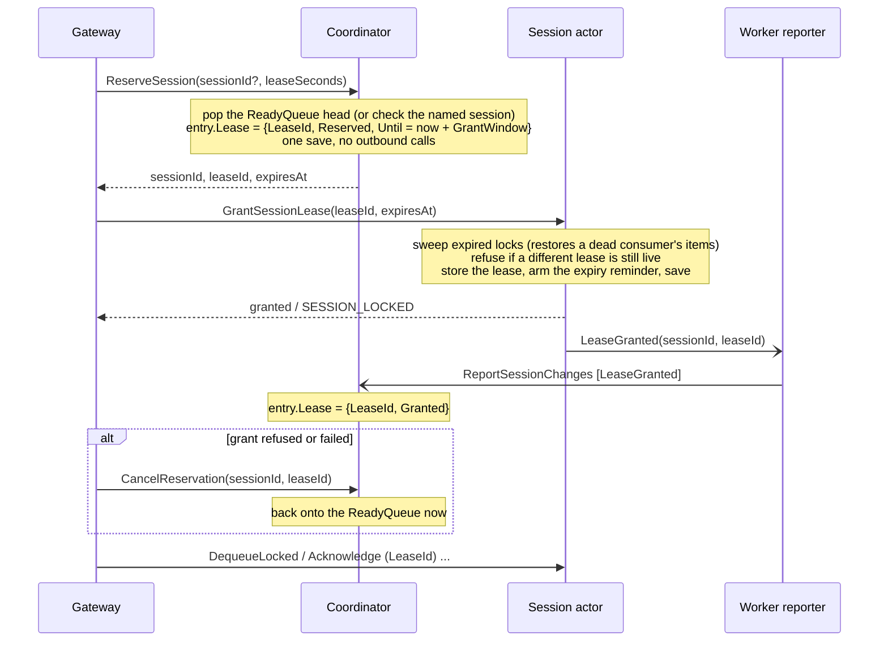

# Session leases on the session actor

> **Status: deferred (2026-10-21).** The coordinator latencies this proposal was written against were
> measured on a kind cluster whose Postgres was throttled to 0.15 CPU (the Bitnami chart's default
> preset). With Postgres at 2 CPU, coordinator calls dropped from 9–10s to 186–436ms. At 10 replicas
> the session test then fills every slot, so the coordinator isn't the limit at the scale tested (see
> [What the session throughput test measured](#what-the-session-throughput-test-measured)). The
> design is kept for when it is: much higher claim rates (many short sessions), or more consumers than
> tested. Revisit if coordinator calls average over 1s on an unthrottled cluster.

## Context

Every session of a queue converges on one `SessionCoordinatorActor`. It does two jobs:

1. **The directory and claim arbitration.** It holds the `ReadyQueue` and `ActiveCount`, and an
   any-available `AcceptSession` takes the head of the `ReadyQueue`. Only one place can do this
   without handing the same session to two consumers.
2. **Every lease, for its whole life.** It mints the lease, records it in `session-lock_{id}`, syncs it
   onto the session actor (`SetSessionLease`), arms a lease reminder (`session-{id}`), renews it
   (`RenewSessionLease`) and ends it (`ReleaseSession` → `ClearSessionLease`, or the reminder).

The second job doesn't need to be central, and it's the expensive one. In one coordinator turn,
`RenewSessionLease` ([SessionCoordinatorActor.cs](../server/src/DaprMQ/SessionCoordinatorActor.cs)) does:

- a state read of `session-lock_{id}`
- a cross-actor `SetSessionLease`, which is itself a lock sweep and a save on the session actor
- a state save
- `UnregisterReminderAsync`
- `RegisterReminderAsync`

That's about five round trips, two of them to the scheduler. `AcceptSession` and `ReleaseSession`
have similar work inside them.

Renewals scale with active streams × time, not with sessions. `ConsumeSession` renews every
`leaseSeconds / 2` inside its delivery loop ([DaprMQGrpcService.cs](../server/src/DaprMQ.ApiServer/Services/DaprMQGrpcService.cs)),
so a stream delivers nothing while its renewal waits.

### What the session throughput test measured

`tools/k8s-throughput --workload sessions` on kind (a laptop), at 10 replicas × 10 sessions (100
streams), with 200ms of work per message:

| Run | Throughput | Busy slots (of 100) |
|---|---|---|
| 100k messages over 1,000 sessions, prefetch 1, lease 30s | 93 msg/s | about 20 |
| 20k messages over 200 sessions, prefetch 10, lease 30s | 94 msg/s | about 18 |
| 20k messages over 200 sessions, prefetch 10, lease 120s | 116 msg/s | about 21 |

From daprd's latency metrics during those runs:

| Call | Average |
|---|---|
| Coordinator calls (`AcceptSession`, `RenewSessionLease`, `ReleaseSession`), seen from the gateway | 6.8–10.4 s |
| The same calls on the worker | 1.3–2.9 s |
| Session-actor calls (`DequeueLocked`, `Acknowledge`), seen from the gateway | 149–372 ms |

Those numbers were taken with Postgres limited to 0.15 CPU and 192Mi. The same benchmark (10
replicas, 20k messages over 200 sessions, 30s lease) with Postgres at 2 CPU / 1Gi:

| | Postgres 0.15 CPU | Postgres 2 CPU |
|---|---|---|
| Prefetch 1 | 57 msg/s, coordinator 10.2 s, session actor 259 ms | **229 msg/s**, coordinator **186 ms**, session actor **10 ms** |
| Prefetch 10 | 87 msg/s, coordinator 9.3 s, session actor 338 ms | **253 msg/s**, coordinator **436 ms**, session actor **14 ms** |

Peak busy slots went from 24–39 of 100 to 97–100. So the coordinator's cost per call, about five
round trips each, matters mostly when every round trip is slow. It's still the one central actor on
the session path, and its load still grows with streams × time, which is why the design below is
kept for higher scale.

Moving renewal out of `ConsumeSession`'s delivery loop on its own (phase 2) was also tried on the
throttled cluster. It gave no throughput gain (88–90 msg/s against 87), and with 15s coordinator
calls, renewals landed after their leases had expired. It was reverted.

## Proposal

**Move lease authority onto the session's own `QueueActor`, and keep only the directory and claim
arbitration on the coordinator.** Lease lifecycle events stay on the session actor. Only events that
change the directory (a claim, and the end of a lease) are reported up to the coordinator, through
the batched path that already carries Active/Empty changes (`SessionActivityReporter` →
`ReportSessionChanges`).

| Event | Today | Proposed |
|---|---|---|
| Any-available claim | coordinator picks, mints the lease, syncs it, saves, arms the reminder | coordinator picks and **reserves** (one save) → gateway calls `GrantSessionLease` on the session actor |
| Targeted claim | coordinator | coordinator reserves the named session → gateway calls `GrantSessionLease` |
| Renew | coordinator: read, sync, save, two reminder calls | session actor: one turn, one save |
| Release | coordinator → `ClearSessionLease` | session actor clears its lease → gateway sends **LeaseEnded** to the coordinator without waiting, and the reporter sends it too as a backup |
| Expiry (consumer crashed) | coordinator reminder → reads the session | session actor's reminder → reports **LeaseEnded** |
| Active / Empty | worker reporter → coordinator | unchanged |
| Restore a dead consumer's locked items | `SetSessionLease` sweeps first | `GrantSessionLease` sweeps first (same code) |

The session actor already holds the synced lease (`ActiveSessionLeaseId`, `ActiveSessionLeaseExpiresAt`)
and already enforces it on every call (`TryAuthorizeSessionLease`), so this makes the enforcing copy
the authoritative one. Lease work then runs on as many actors as there are sessions, instead of
queueing on one.

### Why not a separate per-session lease actor

A per-session "middle man" actor between the session actor and the coordinator gives the same split.
It would keep lease turns from ever queueing behind message turns. But:

- it adds an actor hop to every claim, renewal and release
- it doubles the actors activated per session
- the session actor would still need a synced copy of the lease to enforce on every
  `DequeueLocked` and ack, so the sync call survives

Lease turns are rare and short next to message turns, so sharing the session actor costs little. If
measurements later show lease turns queueing behind message traffic, the lease state can move to its
own actor without changing the protocol below.

## Design

### Call direction

Reentrancy is off ([ADR 0003](../docs/ADR/0003-disable-actor-reentrancy.md)), so no call chain may
re-enter an actor:

- **The coordinator never awaits a session actor inside a turn.** Today's claim, renewal and release
  all do (`TrySyncSessionLeaseAsync`, `ClearSessionLease`). After this change it makes no outbound
  actor calls.
- **Session actors report to the coordinator one way only,** through the worker's reporter. That is
  in-process, batched and outside any actor turn, so a session actor never waits on the coordinator.
- **The gateway makes the two claim calls in sequence.** It calls the coordinator first (reserve),
  then the session actor (grant).

### Claim

- **`ReserveSession`** replaces the coordinator's half of `AcceptSession`. It takes the session off
  the `ReadyQueue` and sets the directory entry's `Lease` to `{LeaseId, Reserved, Until}`, where
  `Until = now + GrantWindow` (10s by default). The entry's `Lease` replaces today's `IsLeasedAsync`
  read of `session-lock_{id}` everywhere the directory needs to know whether a session is leased
  (the `ReadyQueue` invariant and the eviction pass).
- **`GrantSessionLease`** replaces `SetSessionLease`, with one change: it **refuses if a different
  lease is still live**, returning `SESSION_LOCKED`. `SetSessionLease` overwrites unconditionally,
  which is safe today only because the coordinator is the single authority. With the session actor
  as authority, this check is what stops two consumers holding the same session.
- **A successful grant is reported as `LeaseGranted`** through the reporter. The coordinator then
  moves the entry from `Reserved` to `Granted`, so `GrantWindow` only has to cover a grant still in
  flight, not the life of the lease.
- **A refused or failed grant is cancelled straight away.** On `SESSION_LOCKED` or an error, the
  gateway calls `CancelReservation(sessionId, leaseId)`. The coordinator puts the session back on the
  `ReadyQueue` (if the lease ID still matches), and the gateway tries the next session, as a failed
  claim does today.
- **Only a gateway that crashed mid-claim waits for the window.** A `Reserved` entry older than
  `Until` is treated as a lapsed lease. The eviction pass already pushes "Active, not queued, lease
  lapsed" entries back onto the `ReadyQueue` ([session-directory.md](session-directory.md)), so
  recovery takes `GrantWindow` plus up to one `EvictionPeriod` (30s).
- The public API is unchanged. `AcceptSession` (REST and gRPC) still returns
  `sessionId, leaseId, leaseExpiresAt`. The gateway makes the two calls behind it.

### Renew

`RenewSessionLease` moves to the session actor:
1. check the lease ID
2. refuse if the lease has lapsed (`SESSION_LEASE_EXPIRED`)
3. extend `ActiveSessionLeaseExpiresAt`
4. save

That's one turn on an actor that only this session's consumer is calling. The coordinator isn't
told. The directory only cares whether a session is leased, not until when.

**The expiry reminder is checked and re-armed, not replaced.** A renewal doesn't touch the
scheduler. The reminder armed at grant fires at the original expiry. If the lease has been extended
since, the reminder re-arms for the new expiry: one scheduler call per lease period, off the
consumer's path. If the lease has lapsed, the actor ends it (below).

### Lease end

Both a release and an expiry end the same way:
1. **The session actor clears its lease.** On an expiry, its existing lazy reclaim
   (`ReclaimLapsedSessionLocksAsync`) puts any locked items back at the front, as today.
2. **It tells the reporter `LeaseEnded(sessionId, leaseId, remaining)`.** `remaining` is
   `ItemCount + LockCount`, the count `ClearSessionLeaseResponse.Remaining` carries today.
3. **On a release, the gateway also sends `LeaseEnded` to the coordinator directly, without waiting.**
   `ReleaseSessionLease` returns `remaining`. The gateway makes the call outside any actor turn and
   doesn't wait for its result, so nothing blocks on the coordinator. The reporter's copy, at most one
   `ReportTick` (10s) later, covers a direct call that fails.
4. **The coordinator applies the first copy with today's `ApplyLeaseEndAsync`.** `remaining == 0`
   makes the entry Idle. Otherwise the session goes back on the `ReadyQueue`. It first clears the
   entry's `Lease`, but only if `leaseId` matches, so the second copy, or a late report for an old
   lease, does nothing.

A consumer that releases a session is therefore reflected straight away in the usual case, both in
the session being claimable again and in `ActiveCount`. An expiry has no gateway behind it, so it
goes through the reporter alone.

### What stays on the coordinator

- `RegisterSession`
- `ReportSessionChanges`, with a new `LeaseEnded` change kind
- `ReserveSession` (any-available and targeted)
- the eviction pass
- `ActiveCount` for the scaler

None of them makes an outbound actor call. Its per-call cost becomes a state read and a save,
instead of today's 150–300ms of service time on the kind measurements.

## State

| Key | Today | Proposed |
|---|---|---|
| Coordinator `session-lock_{id}` | the lease (ID, created, expiry) | **removed** |
| Coordinator reminder `session-{id}` | the lease expiry | **removed** |
| Coordinator directory entry | `Active`, `Queued`, check times | adds `Lease: { LeaseId, State: Reserved \| Granted, Until }?` |
| Session actor `metadata` | `ActiveSessionLeaseId`, `ActiveSessionLeaseExpiresAt` (a synced copy) | the same fields, now authoritative |
| Session actor reminder | none | `lease-expiry`, armed at grant and re-armed on extension |

## Migration

A lease lives at most `MaxLeaseSeconds` (300s), and the session actor already holds every live lease,
because `SetSessionLease` succeeds before a claim or renewal reports success. So the switch needs no
data migration, only a release where old and new behaviour overlap:

1. **Release N (dual).**
   - The session actor gets `GrantSessionLease`, `RenewSessionLease` and `ReleaseSessionLease`, and
     reports `LeaseEnded`.
   - The coordinator keeps `AcceptSession`, `RenewSessionLease` and `ReleaseSession` as shims that
     forward to the new calls, for gateways still on release N-1.
   - New gateways call the new paths.
   - The coordinator ignores old `session-{id}` reminders: they find no `session-lock_{id}`, or
     delete one and do nothing else.
   - Leases granted before the upgrade are already on the session actor and end through it.
2. **Release N+1.**
   - Remove the shims, `session-lock_{id}` handling and `TrySyncSessionLeaseAsync`.
   - Any leftover `session-lock_{id}` keys are deleted lazily when an entry is next touched.

## Behaviour changes

- **Renewals never reach the coordinator.** This removes the largest share of its calls and all of
  its cross-actor and scheduler work on the session path.
- **A claim is two short calls instead of one long one.** The coordinator half no longer waits on the
  session actor or the scheduler. A refused grant adds a third, `CancelReservation`.
- **A released session is claimable again straight away,** as today, through the gateway's direct
  `LeaseEnded`. When that call fails, it's up to one reporter tick (10s) later. After an expiry
  it's unchanged: it waits for the reminder.
- **A gateway that crashes mid-claim strands the session for `GrantWindow` plus up to 30s.** Today
  there's no such gap, because the claim is one call.
- **A conflicting grant is refused, not overwritten.** This is a safety improvement. Today a stale
  coordinator decision would overwrite a live lease.

## Tests (TDD order, per CLAUDE.md)

1. **Integration (HTTP and gRPC contract, unchanged shapes).**
   - accept, renew and release round trips
   - a crashed consumer's session is reclaimed after expiry, with its locked items at the front
   - two consumers can't hold one session
   - `SessionReentrancyTests` still passes with reentrancy off
2. **Gateway.**
   - `AcceptSession` calls `ReserveSession`, then `GrantSessionLease`
   - on `SESSION_LOCKED` or a failed grant it calls `CancelReservation`, then tries again
   - a release sends `LeaseEnded` to the coordinator without waiting, and a failure there doesn't fail
     the release
   - renew and release go to the session actor (`ActorMethodNames` constants)
   - `ConsumeSession` renews against the session actor
3. **Session actor** (mocked `IActorStateManager`).
   - grant: sweeps first; refuses a different live lease; accepts the same lease again (idempotent);
     arms the reminder
   - renew: extends; refuses a lapsed or wrong lease
   - the reminder re-arms on an extended lease and ends a lapsed one
   - a grant reports `LeaseGranted`; every lease end reports `LeaseEnded` with `remaining`
4. **Coordinator.**
   - `ReserveSession` pops the `ReadyQueue` and sets `Lease = Reserved` with no outbound calls
   - `LeaseGranted` moves a matching reservation to `Granted`
   - `CancelReservation` re-queues a matching reservation and ignores a stale one
   - `LeaseEnded` clears a matching `Lease` (and ignores a stale one or a second copy), then applies
     the lease end
   - the eviction pass re-queues a `Reserved` entry past `Until`, but never a `Granted` one
5. **Perf.** `tools/k8s-throughput --workload sessions` at 10 replicas, 20k messages over 200 sessions,
   prefetch 10, lease 30s, before and after. Expect coordinator latency (daprd metrics) to drop from
   seconds to tens of milliseconds, and throughput to match at least the 120s-lease run (116 msg/s)
   at a 30s lease.

## Phases

1. **Lease authority on the session actor**, with explicit renewal as today, following the migration
   above.
2. **Renew in the background.** `ConsumeSession` renews from its own task, outside the delivery loop,
   so a slow renewal no longer stops deliveries. Its stream writes go through one write lock (see
   [Related work](#related-work)), and total automatic renewal is capped, as message lock renewal
   is (see [decision 1](#1-how-a-lease-is-kept-alive)).
3. *(Optional, if commits/s becomes the limit)* **Sliding lease.** Every authorized `DequeueLocked` or
   ack extends the lease in the turn it already saves in, so explicit renewal is only needed when a
   handler runs longer than half the lease. See [decision 1](#1-how-a-lease-is-kept-alive).
4. *(If claims become the limit)* **Shard the coordinator by session hash.** Arbitration is the only
   central work left, so N coordinators each own a slice of the `ReadyQueue`, and the scaler sums
   their `ActiveCount`s.

## Alternatives considered

The alternatives for keeping a lease alive, ending a release and timing a reservation are weighed in
[Decisions](#decisions). These are the alternatives to the proposal as a whole.

| Alternative | Why not (now) |
|---|---|
| A background renewer in `ConsumeSession`, leaving lease authority where it is | Removes the stall from the delivery loop but not the load. The coordinator still does every renewal's five round trips, and claims still queue behind them. Worth doing anyway (phase 2). |
| Longer default leases | Fewer renewals (+23% at 120s), but a crashed consumer holds its session for longer. That moves the cost; it doesn't remove it. |
| A per-session lease actor | See [Why not a separate per-session lease actor](#why-not-a-separate-per-session-lease-actor). |
| Shard the coordinator first | Spreads today's expensive calls instead of removing them. Lease work would still be about 5 round trips per renewal, just on N actors. Better as phase 4, on top of cheap calls. |

## Decisions

Each decision is judged mainly on **blocking** (what waits on what, and inside whose turn) and
**latency** (how long a consumer or a session waits). The timings that matter are the reporter's
`ReportTick` (10s) and the coordinator's `EvictionPeriod` (30s). Coordinator latencies assume this
proposal is in place, so a coordinator call is one read and one save (tens of milliseconds), not
today's 7–10s.

### 1. How a lease is kept alive

**Chosen: explicit renewal, sent to the session actor, from a background renewer in `ConsumeSession`
(phase 2).**

- **Blocking:** one extra turn on the session actor per `leaseSeconds / 2` per stream, behind that
  session's own dequeues and acks. At a 30s lease and 100 streams that's about 6.7 turns/s, spread
  over 100 actors. Nothing waits on the coordinator.
- **Latency:** none for consumers once renewal is off the delivery loop. Kept in the loop, it would
  stall each stream for one session-actor round trip (150–370ms measured) every 15s, about 1–2%.
- **Commits:** one per renewal, about 7/s against the ~300/s kind manages, or 2–3% of the capacity
  that limits session throughput today.
- **Failure detection:** the lease tracks whether the consumer process is alive, not whether it's
  making progress. A hung handler with a working renewer keeps its session. That's bounded the way
  message locks are, by a cap on total automatic renewal (as `MaxAutoLockRenewalDuration` does
  for message locks).
- **Behaviour:** matches Azure Service Bus, where session locks are only renewed explicitly and the
  processor renews them in the background. `RenewSessionLease` keeps its meaning.

**Discounted: a sliding lease, where every authorized `DequeueLocked` or ack extends the lease.**

- **Blocking:** none added for active streams. The extension is written in a save those turns
  already make. A quiet-stream renewer is still needed for handlers longer than `lease / 2`, but
  rarely runs.
- **Latency:** none added, and no renewal round trips at all while a stream is busy.
- **Commits:** none added.
- **Failure detection:** the lease tracks progress. A hung handler stops calling, so its session
  frees itself when the lease lapses, unless the quiet-stream renewer keeps it alive.
- **Why not now:** once renewal is off the coordinator and off the delivery loop, explicit renewal
  costs 2–3% of commits and no stalls. A sliding lease would mainly buy simplicity and
  progress-based failure detection, at the cost of diverging from Service Bus. It's kept as optional
  phase 3, for when commits/s is the binding limit.

**Discounted: keep renewal on the coordinator, with only a background renewer.**

- **Blocking:** removes the stall from the delivery loop, but every renewal still runs about five
  round trips inside the single coordinator, so claims and releases still queue behind renewals.
- **Latency:** coordinator calls stay at the measured 7–10s under load.
- **Why not:** it moves the wait from the stream to the coordinator queue; it doesn't remove it.

**Discounted: longer default leases.**

- **Blocking and latency:** fewer renewals (+23% throughput at 120s against 30s). But a crashed
  consumer's session waits a full lease before anyone else can claim it, which is up to 300s at the
  maximum.
- **Why not:** it trades throughput for recovery time instead of removing the cost.

### 2. Whether a release waits for the coordinator

**Chosen: the gateway tells the coordinator directly without waiting, and the reporter sends the
same report as a backup.**

- **Blocking:** none. The session actor's release is one turn, and the gateway's call to the
  coordinator is made outside any actor turn and isn't awaited. The client's stream has already ended,
  so no SDK slot waits either.
- **Latency:** a released session that still has messages is claimable again almost immediately in
  the usual case, and within one `ReportTick` (10s) when the direct call fails. `ActiveCount` is
  exact in the usual case.
- **Cost:** one coordinator turn per release (unbatched), plus the batched backup report. The second
  copy is harmless because of the lease-ID match.

**Discounted: through the reporter only (asynchronous).**

- **Blocking:** none, the same as the chosen option.
- **Latency:** a released session that still has messages waits up to 10s (one tick) before anyone
  can claim it, plus the coordinator's processing. A drained session isn't affected. `ActiveCount`
  lags up to 10s, which is harmless against KEDA's 30s or longer cooldown.
- **Cost:** the lowest. Many releases share one batched report, which helps at high churn (for
  example 300 sessions of 2).
- **Why not:** it gives up today's immediate claimability for released sessions. The chosen option
  keeps that for one extra unawaited call.

**Discounted: the session actor waits for the coordinator inside its release turn (synchronous).**

- **Blocking:** the session actor is held for the coordinator's latency, and the next holder's grant
  and dequeues wait behind it. That's tens of milliseconds while the coordinator is quiet, but seconds
  whenever it queues, and it ties the session path back to the coordinator.
- **Latency:** immediate claimability, and an exact `ActiveCount`.
- **Why not:** it puts the coordinator back on an actor's path, which is what this proposal removes.

**Discounted: the gateway waits for the coordinator after the release.**

- **Blocking:** no actor is held, only the gateway's server-side cleanup.
- **Latency:** the same as the chosen option in the usual case.
- **Why not:** waiting gains nothing over sending without waiting, because nothing acts on the
  result. A failure still needs the reporter backup.

### 3. How long a reservation lives, and how it ends early

This only matters when the second step of a claim doesn't complete: the gateway crashes between
`ReserveSession` and `GrantSessionLease`, or the grant is refused. A lapsed reservation is only
re-queued by the next eviction pass, so recovery takes the timeout plus up to 30s.

**Chosen: a short `GrantWindow` (10s), ended early by `CancelReservation`, and made safe by
`LeaseGranted`.**

- **Blocking:** none. All three are short coordinator turns with no outbound calls, and
  `LeaseGranted` goes through the batched reporter.
- **Latency:** a refused or failed grant re-queues the session immediately. A gateway that crashes
  mid-claim strands the session for 10s plus up to 30s.
- **Safety:** once `LeaseGranted` arrives, the entry is `Granted` and is never re-queued by the
  window, so a slow grant can't cause the session to be offered while it's held.
- **Cost:** one batched report per claim, and one extra call on the failure path only.
- **Remaining edge:** a grant that's still in flight when the window lapses, and whose `LeaseGranted`
  hasn't arrived yet, can be re-offered. The next claimant gets `SESSION_LOCKED` (the session actor
  refuses a different live lease) and cancels, so this costs churn, not correctness.

**Discounted: `Until = expiresAt` (the lease length), with no cancel or grant report.**

- **Blocking:** none.
- **Latency:** a session stranded by a crashed gateway or a refused grant waits the full lease plus
  up to 30s: 60s at the default 30s lease, 330s at the 300s maximum.
- **Simplicity:** the most of the four. It reuses the eviction pass's lapsed-lease rule as it is,
  with no new calls or change kinds.
- **Why not:** a refused grant (`SESSION_LOCKED`) is an ordinary event, not a rare crash, so the full
  wait would hit normal operation. It's the fallback if phase 1 needs to be minimal.

**Discounted: a short window without `LeaseGranted`.**

- **Blocking:** none.
- **Latency:** 10s plus up to 30s after a crash, but the coordinator can't tell a held lease from a
  lapsed reservation. Once the window lapses it re-offers sessions that are being consumed, and every
  claimant gets `SESSION_LOCKED` until that lease ends: two wasted calls per attempt, adding claim
  latency for everyone.
- **Why not:** it's safe (the session actor refuses), but the churn grows with lease length and
  claim rate.

**Discounted: `CancelReservation` alone, with `Until = expiresAt`.**

- **Latency:** refused grants recover immediately, but a crashed gateway still strands the session
  for a lease plus up to 30s.
- **Why not:** it's half of the chosen option. Adding `LeaseGranted` is what makes the short window
  safe, and costs one batched report per claim.

### Summary

| Decision | Chosen | Blocking | Latency | Discounted |
|---|---|---|---|---|
| 1. Keeping a lease alive | Explicit renewal on the session actor, from a background renewer | one cheap session-actor turn per 15s per stream | none for consumers | sliding lease (phase 3); coordinator renewal with a background renewer; longer leases |
| 2. Release and the coordinator | Gateway sends `LeaseEnded` without waiting; reporter as backup | none | claimable at once normally; ≤10s if the direct call fails | reporter only; session actor waits in its turn; gateway waits |
| 3. Reservation | 10s `GrantWindow` + `CancelReservation` + `LeaseGranted` | none | immediate on a refused grant; 10–40s after a crash | `Until = expiresAt`; short window without `LeaseGranted`; cancel only |

## Related work

These are the session throughput findings this proposal doesn't address. They cut per-message cost,
not coordinator load:

- **Batch queued acks per `ConsumeSession` stream** into one `AcknowledgeBatch`, as the queue `Consume`
  stream does. This only helps above prefetch 1. A Nack or DeadLetter frame flushes pending acks
  first, since a Nack returns its message to the front.
- **Ack-and-take-next.** One session-actor call that settles message N and locks N+1, for strictly
  sequential (prefetch 1) consumers. It halves calls and commits per message.
- **Serialize `ConsumeSession` stream writes.** Its reader task writes error frames while the poll
  loop writes deliveries, with no write lock. `Consume` already has one. Phase 2 adds a third writer,
  so it needs one.
